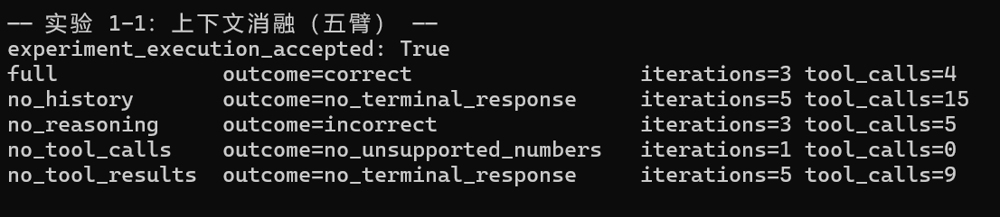
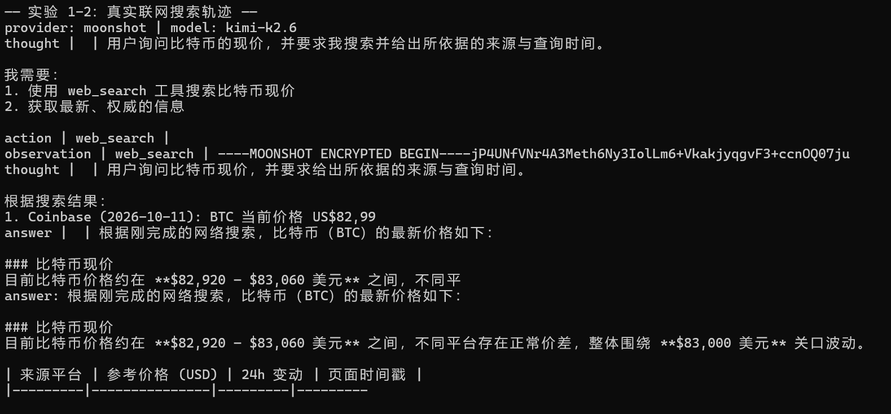
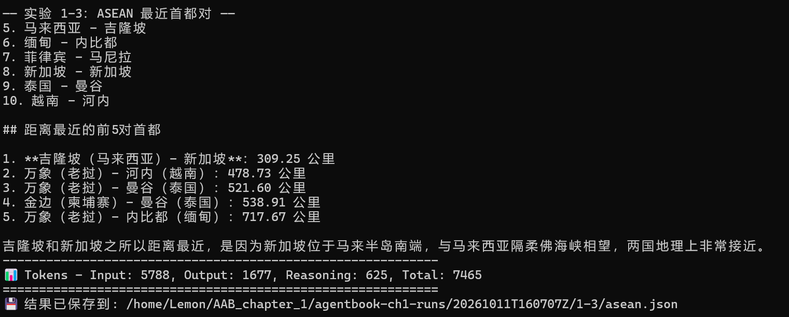
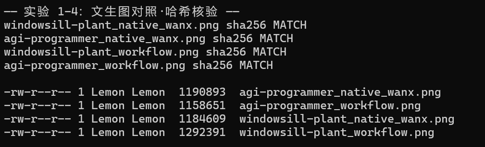

# 第一章学习打卡笔记：理论整理 + 实验 1-1 ~ 1-4

> 《深入理解 AI Agent》第一章的学习记录：前半部分是本章核心理论的自有整理，后半部分是四个实验在 WSL2（Debian 13）内的真实运行与心得。理论标注书籍小节来源，实验截图出自本人终端，全部证据为真实运行产物。

---

# 第一部分：理论整理

## 1. 现代 Agent = LLM + 上下文 + 工具

这个公式只描述 Agent 内的实现，不包含交互的 Environment。

- **LLM** 是 Agent 的大脑，LLM 的能力也来自两部分：
  - 预训练所积攒的世界知识与语言能力
  - 后训练所固化的决策策略
- **上下文**是 Agent 在每个决策点收到并保留的信息表示：用户记忆、环境观察、领域知识、自身状态、任务进展
- **工具**是 Agent 用来感知或改变外部世界的接口

在经典的强化学习和控制论视角下，Agent 与 Environment 是闭环交互的两方，而不是彼此的组成部分：

- **环境**包含文件、数据库、网页、用户、其他 Agent 以及物理或仿真世界
- **Agent**只能通过观察和行动接口与它交互
  - **Model**负责策略决策
  - **Harness**是 Agent 边界内环绕模型的*运行与治理层*，负责构造上下文、暴露工具接口、维护循环和状态，并实施权限、验证与纠正

> 来源：书 `book/chapter1.md §现代 Agent = LLM + 上下文 + 工具`

## 2. 观察空间与动作空间

Harness 把环境返回的观察转换为模型能够处理的上下文，再把模型选择的行动转换为对环境的工具调用。

所以在**底层模型固定时，提升 Agent 任务表现最主要的系统工程手段，往往就是重新定义或扩展观察空间与动作空间**——站在 Agent 内部的角度，就是扩展上下文和工具。

> 来源：书 `book/chapter1.md §观察空间与动作空间：模型与世界的接口`

## 3. 工具：Agent 的手脚

按 Agent 与外界互动的方向，把工具分为五类：

- **感知工具**：搜索引擎、文件系统、API、数据库——环境到 Agent 的观察通道
- **执行工具**：代码执行、文件操作、系统命令——Agent 到环境的行动通道
- **协作工具**：委托子 Agent、请求人类确认、多 Agent 协调
- **事件触发工具**：邮件到达、定时触发、Webhook 回调——不是 Agent 主动调用，而是外部事件驱动 Agent 启动
- **用户沟通工具**：文字、语音、邮件——Agent 主动向用户传递信息

工具调用的流程分四步：

```
第一步：声明工具                第二步：模型决定调用
tools: [{                      assistant: {
  name: "get_weather",           tool_calls: [{
  parameters: {                    function: "get_weather",
    city: "string"                 arguments: {city: "北京"}
  }                              }]
}]                             }]

第三步：结果追加到上下文        第四步：模型基于结果回复
tool: {                        assistant: {
  tool_call_id: "call_1",        content: "北京今天 28°C，晴。"
  content: '{"temp":28,"sky":"晴"}' }
}                              }
```

开发者只需定义工具和执行工具调用，模型自主完成"要不要调用、调哪个、传什么参数"的决策。

> 来源：书 `book/chapter1.md §工具：Agent 的手脚`

## 4. LLM：模型即 Agent

当模型本身成为产品，LLM 就是 Agent 的大脑：预训练带来世界知识与语言能力，后训练固化决策策略。

> 来源：书 `book/chapter1.md §LLM：Agent 的大脑`

## 5. 上下文：Agent 的眼睛

每次调用 LLM 时的上下文由五个部分构成：

- **系统提示词**
- **工具定义**
- **用户消息**
- **模型回复**
- **工具执行结果**

前两项（系统提示词 + 工具定义）是**静态前缀**，后三项（用户消息 + 模型回复 + 工具执行结果）是随交互不断增长的**动态消息历史**。这五个部分共同构成了 LLM 每次推理时的上下文——要验证每个组件是否不可或缺，最直接的方法就是**消融实验**：先去掉 A 组件看系统是否还正常，再去掉 B 组件，以此类推。实验 1-1 正是按这个思路做的。

> 来源：书 `book/chapter1.md §上下文：Agent 的眼睛`

---

# 第二部分：实验打卡

## 打卡 1｜实验 1-1：上下文消融——答案正确 ≠ 看见工具结果

**理论与实验的对应**：上文"上下文五部分"中，"工具执行结果"是动态消息历史的一部分；消融实验就是每次删掉一类，观察 Agent 行为怎么变。这正对应"观察空间决定模型能看到什么"：程序本地执行了工具、拿到了结果，不等于模型收到了这个观察——`no_tool_results` 砍断的就是"环境观察 → 模型可见上下文"这条通路。

**运行记录**（硅基流动 DeepSeek-V4-Flash，guarded 任务）：



单组对照（`full` vs `no_tool_results`，计算器任务）：full 2 轮 1 次调用；no_tool_results 8 轮 7 次调用、工具消息内容为空、模型最终放弃工具自己心算。

**踩坑记录**：
1. 硅基流动原默认模型已下线，不带 `--model` 直接 403 Model disabled，还伴随 `NameError: name 'openai' is not defined` 的次生报错——主因是模型下线，不是网络问题。
2. 先用 `main.py --mode ablation` 跑过一次，但那份 JSON 没有 model 字段，无法证明用了哪个模型；换 `run_experiment_1_1.py` 后每臂都持久化请求与响应，证据才闭环。

**学习笔记**：这次实验让我把三件事分开了：`completed` 只说明循环结束了，答案正确只说明数字对，而"有工具依据"要看轨迹里工具消息的内容是否真的进了下一轮请求。最意外的是 `no_reasoning` 被判 incorrect，原因不是没算出来，而是工具参数写错了量级（2.1 而不是 2100000）——最终总额碰巧接近正确值，但中间换算全错。书中 Kimi K3 的记录里 no_reasoning 是 correct，我们这次是 incorrect，说明书里的对照表是特定模型与任务的单次记录，不是所有模型的必然行为。判断证据时我只认 `iterations`、`tool_calls` 和每轮请求的 messages，不看模型口头怎么说。

**源码定位**：`chapter1/context/agent.py:877-892`——`NO_TOOL_RESULTS` 模式下工具消息内容替换为 `hidden_result_content`（默认空串，`agent.py:41`），消息仍在但内容为空。

**来源**：书 `book/chapter1.md §上下文 / §观察空间与动作空间`；任务书 §4；证据 `agentbook-ch1-runs/20261011T160707Z/1-1/five-arm/evidence.json`

---

## 打卡 2｜实验 1-2：真实联网搜索——"我搜索了"三个字不是证据

**理论与实验的对应**：web_search 属于五类工具里的**感知工具**，它不改变世界，只扩展 Agent 的观察空间。整个实验走的是 ReAct"想→做→看"循环。先跑的 `offline-demo` 是预设轨迹，用来看懂循环结构；真实联网才是验收项。

**运行记录**（Moonshot kimi-k2.6，`--max-steps 5`）：



轨迹 5 步：thought → action(web_search) → observation → thought → answer；最终回答引用 Coinbase（$82,974.89）/ eToro（$82,921.27）/ TradingView（$83,062.00）与页面时间戳，与搜索内容对得上。

**踩坑记录**：
1. 默认模型 `kimi-k3` 和 `kimi-latest` 都 404。用 `GET /v1/models` 实测账户只有两个模型：`kimi-k2.6`、`kimi-k2.7-code`。
2. `kimi-k2.6` 只接受 `temperature=1`，仓库发 0.6 报 400。极小补丁 `agent.py:25`（`_reasoning_safe_temperature` 增加 "kimi-k2" 分支）+ 测试，44 passed，diff 存档。
3. Moonshot 组织并发上限为 1：1-2 和 1-4 的改写节点同时调 Kimi 触发 429——所有 Kimi 调用必须串行。

**学习笔记**：模型在回答里写"我搜索了网页"一文不值——它连没联网都能这么写。真正的证据分两层：轨迹里有 `action`（工具调用事件）和 `observation`（工具返回内容）条目，且最终回答里的数字能对上 observation 里的来源。这次的 429 也让我体会到 Harness 的意义：并发限制、temperature 兼容、重试策略这些"模型之外"的事，全是 Harness 的活，模型本身完全不知道。另外离线 demo 的轨迹是硬编码的，它能帮我理解循环结构，但绝不能当真实搜索写进报告。

**源码定位**：`chapter1/web-search-agent/main.py:176-184`（offline-demo 分支）→ `agent.py:553`（预设轨迹构造）；真实搜索分发在 `agent.py:453`；`agent.py:330`（请求 temperature 处理）。

**来源**：书 `book/chapter1.md §工具 / §ReAct 循环`；任务书 §5；证据 `agentbook-ch1-runs/20261011T160707Z/1-2/live.json`

---

## 打卡 3｜实验 1-3：搜索 + 托管代码执行——事实归搜索，计算归代码

**理论与实验的对应**：这个任务同时用到**感知工具**（web_search_call 查首都坐标与来源）和**执行工具**（code_interpreter_call 算球面距离），完整走了工具调用的四步：声明 → 模型决定调用 → 工具执行 → 结果回填上下文。dry-run 不产生真实调用，它只是把将要发送的请求配置打印出来。

**运行记录**（DashScope 大陆站，Responses API 单任务）：



答案：**吉隆坡-新加坡 309.25 km** 为最近一对；响应 output_items 含 `web_search_call` 与 `code_interpreter_call`；citations 含 news.cn / 百度百科 / wikipedia 等来源链接；tokens 7465。

**踩坑记录**：仓库默认 DashScope 国际站端点（dashscope-intl），我的 Key 是大陆站 → `InvalidApiKey`。改用环境变量 `DASHSCOPE_BASE_URL` 指到大陆站 `/compatible-mode/v1` 后一次通过，**没有改代码**——这正是"环境变量是配置，代码是逻辑"的边界。

**学习笔记**：这个实验让我看清了"职责边界"：哪些首都离得近、各自坐标是什么，模型不可能背得准，必须靠搜索；但拿到坐标后算球面距离是确定性计算，交给托管 Python 比让模型心算可靠得多。验证时我看的是响应对象里的 `output_items` 和 citations，而不是模型在回答里声称"我搜了、我算了"。本地自己写段 Python 算出 309.25 不代表服务端工具执行过——服务端证据和本地验算是两回事，前者是验收依据，后者只是交叉核对。

**源码定位**：`chapter1/search-codegen/config.py:33-35`（`DASHSCOPE_BASE_URL` 环境变量覆盖点，本次用它切换大陆站）。

**来源**：书 `book/chapter1.md §工具`；任务书 §6；证据 `agentbook-ch1-runs/20261011T160707Z/1-3/asean.json`

---

## 打卡 4｜实验 1-4：文生图对照——改写节点是"具象化"还是"加戏"

**理论与实验的对应**：工作流路线 = "先由 Kimi 改写提示词，再用通义万相出图"；原生路线 = 把原始需求直接交给出图模型。这对应书里"编排模式：工作流与自主"的讨论。改写节点本质上是**扩展上下文的提示词工程**：它把一句宽泛需求变成充满具体细节的 SD 风格提示词，观察空间被大幅改写。

**运行记录**（最小对照 2 需求 × 2 路线 = 4 张图，全部真实生成）：



4 张图 SHA-256 与 manifest 逐一 MATCH。宽泛需求 `agi-programmer`（"帮我画一个 AGI 实现以后程序员的工作场景"）的改写新增了大量**用户没有要求**的细节：sci-fi 概念艺术、全息代码界面、AR 眼镜、神经接口头戴、霓虹城市背景、octane render……而具体需求 `windowsill-plant` 的改写主要是风格词与"morning sunlight"之类的合理细化。

**踩坑记录**：
1. `Config.validate()` 硬性要求 KIMI/DASHSCOPE/GEMINI/OPENAI 四把 Key 同时存在，即使只跑 workflow 也如此。经同意后做极小补丁：`validate(route)` 只校验所选路线需要的 Key（diff 存档）。
2. 本环境代理实测不通 Google（generativelanguage.googleapis.com 连接失败），Gemini 原生路线无法运行。经同意后新增 `native_wanx` 路线：不经改写、直接用同一个万相模型出图——这样 workflow 和 native 的差异只能归因于"改写节点"本身，排除了模型差异的混淆。上游 Gemini 路线保留未删，标 BLOCKED。

**学习笔记**：这次对照最直观的收获是：改写节点对宽泛需求的"具象化"不一定是用户要的——全息界面、AR 眼镜这些细节是 Kimi 的审美偏好，不是需求的一部分，这叫"没有依据的添加"；而同一模型的原生直出至少忠实于用户原话。所以"工作流更好"不能一概而论：对具体需求，改写是合理细化；对宽泛需求，改写可能替用户做了他没做的决定。另外我特意让两条路线用同一个出图模型，否则 workflow 对比 native 的差异里混着"模型不同"和"有没有改写"两个变量，结论就说不清了——这也是书里提醒的"不能把所有好坏归因于工作流"。

**源码定位**：`chapter1/image-gen-workflow/pipeline.py:348`（`run_workflow_route`：改写→生图两节点）、`pipeline.py:352`（Kimi 改写调用）、`pipeline.py:150`（万相异步提交+轮询）。

**来源**：书 `book/chapter1.md §编排模式`；任务书 §7；证据 `agentbook-ch1-runs/20261011T160707Z/1-4/images/` 与 `1-4/manifests/`

---

## 总来源清单

- 书籍理论：《深入理解 AI Agent》本地仓库 `ai-agent-book/book/chapter1.md`（§现代 Agent = LLM + 上下文 + 工具 / §观察空间与动作空间 / §工具 / §LLM / §上下文 / §ReAct 循环 / §编排模式）
- 实验要求：《CHAPTER1_WSL_AGENT_TASK (2).md》§4~§7；互动节奏《CHAPTER1_LEARNING_PATCH.md》检查点 A~E
- 全部运行证据：`/home/Lemon/AAB_chapter_1/agentbook-ch1-runs/20261011T160707Z/`（progress.md、FINAL_REPORT.md、各实验 JSON/日志/图片）
- 源码定位均已给出仓库相对路径与真实行号，可 `grep` 核实
